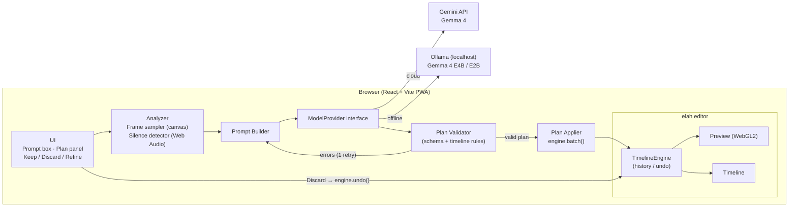
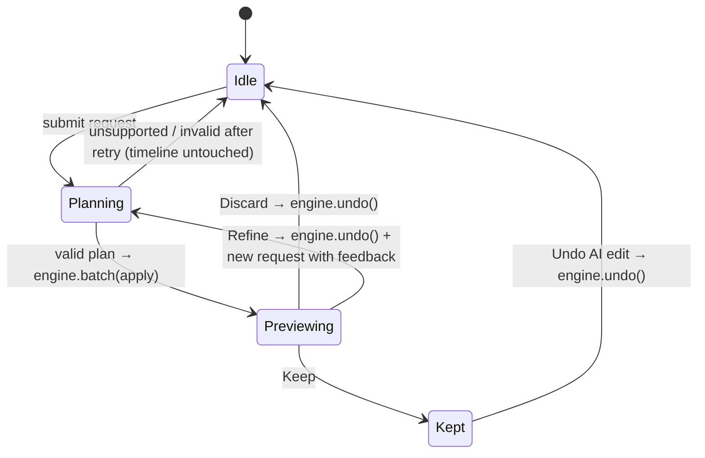

# Watch-and-Cut — High-Level Design

> Tell it what reel you want. Gemma 4 watches your video, proposes the cut, and you keep it or undo it in one tap.

| | |
| --- | --- |
| **Event** | Hacktoberfest Hack Day 2026 · Hyderabad (MLH × DEV × React Hyderabad) |
| **Primary track** | Build on elah |
| **Also targeting** | Best Use of Gemma 4 (cloud mode) · Best Open-Source AI Project (offline mode). Multi-category eligibility to be confirmed with organizers. |
| **Build window** | 120 minutes |
| **License** | Apache-2.0 (matches elah) |

---

## 1. Problem

Turning a long phone recording into a short reel means scrubbing the whole video, guessing where to cut, trimming dead air, and typing captions by hand. It is slow, especially on a phone.

**User:** a creator, student, or community organizer with a 1–3 minute clip who wants a 15–30 second reel.

**One-sentence value:** Describe the reel in plain English, and the app proposes a reviewable, captioned cut that you can keep, refine, or undo in one step.

## 2. Goals and non-goals

**Goals**
- Turn a natural-language request into a **structured edit plan** (JSON), never direct pixel or DOM edits.
- **Validate** the plan and apply only valid operations to the elah timeline.
- **Preview** the proposed cut in the real editor before committing.
- Offer **Keep / Discard / Refine**, with the whole AI action **undoable in one step**.
- Two model backends behind a single interface: **Cloud** (Gemma 4 via Gemini API) and **Offline** (Gemma 4 E4B/E2B via local Ollama).
- A mobile-friendly PWA with 9:16 as the default stage.

**Non-goals (for the 2-hour build)**
- A React Native or native mobile app. elah is web-only, and the track requires a browser-based experience.
- Multi-video projects or B-roll assembly.
- Audio understanding by the model. Speech gaps are found with deterministic signal processing instead.
- Server-side rendering or accounts. Export uses elah's in-browser MP4 export.

## 3. User flow

```
Upload video → type request → [AI plan] → preview on timeline → Keep | Discard | Refine
                                                                     │       │        │
                                                              committed   one undo   undo + re-plan
                                                                                     with feedback
```

Demo script, under 2 minutes:
1. Load a 90-second talking-head clip.
2. Type: *"Make a 20-second reel of the best moments with captions."*
3. Plan panel shows 3 segments with reasons and captions. The timeline updates and plays.
4. **Refine:** *"Drop the second part, make captions shorter."* → new plan.
5. **Discard:** the timeline restores to the original in one step.
6. Unsupported request (*"Add a dancing robot"*) → clean "unsupported" message, timeline untouched.
7. Flip the **Offline** toggle → same flow on a short clip, no internet.

## 4. Architecture



### Components

| Component | Responsibility | Notes |
| --- | --- | --- |
| **UI shell** | Upload, prompt box, mode toggle, plan panel, Keep / Discard / Refine buttons, export | Mobile-first layout, 9:16 stage |
| **elah editor** | `EditorProvider`, `Preview`, `Timeline` from `@elah/editor` | The single source of truth for the project |
| **Analyzer** | Samples 8–12 frames as 512px JPEGs with timestamps; finds speech pauses in the audio | Pure browser code, no AI |
| **Prompt Builder** | Combines the user request, video metadata, candidate cut points, frames, and the plan schema | Same prompt for both backends |
| **ModelProvider** | `generatePlan(input) → rawJson`, with `GeminiProvider` and `OllamaProvider` implementations | Model ID and endpoint come from config |
| **Plan Validator** | Parses JSON, checks the schema, checks the timeline rules (§6), and returns path-addressed errors | Errors are sent back to the model once for self-correction |
| **Plan Applier** | Translates a valid plan into elah engine calls inside **one** `engine.batch()` | One batch = one undo entry |
| **Session state** | Tracks `idle → planning → previewing → kept/discarded` | See §7 |

## 5. Edit plan schema

The model returns **only** this JSON. Times are in seconds; the applier converts them to integer frames (`Math.round(sec * fps)`), because elah works in frames.

```json
{
  "status": "ok",
  "summary": "20s reel: intro hook, main tip, closing line",
  "operations": [
    { "op": "keep_segment", "start": 3.2, "end": 9.8, "reason": "Strong opening hook" },
    { "op": "keep_segment", "start": 41.0, "end": 49.5, "reason": "Main tip, clear delivery" },
    { "op": "keep_segment", "start": 77.4, "end": 81.0, "reason": "Clean sign-off" },
    { "op": "add_caption", "segment": 0, "text": "3 tips nobody tells you" },
    { "op": "add_caption", "segment": 1, "text": "Tip #1: ship small" },
    { "op": "add_transition", "after_segment": 0, "kind": "fade" },
    { "op": "add_title", "text": "Hack Day 2026", "duration": 1.5 }
  ]
}
```

Unsupported or unclear request:

```json
{ "status": "unsupported", "reason": "Generating new visuals (a dancing robot) is not an available operation." }
```

**Allowed operations (closed set)**

| Op | Fields | Maps to elah |
| --- | --- | --- |
| `keep_segment` | `start`, `end`, `reason` | `splitClip` at boundaries → `removeClip` on the unkept pieces → `moveClip` to close gaps |
| `add_caption` | `segment`, `text` | `addClip({ type: 'text', ... })` on a text track, aligned to the kept segment |
| `add_title` | `text`, `duration` | Text clip at frame 0 |
| `add_transition` | `after_segment`, `kind: fade \| slide \| wipe` | `addTransition` between adjacent clips on the same track |

Anything else is rejected by the validator.

## 6. Validation rules

The validator runs before anything touches the timeline. Each failure produces a path-addressed message, such as `operations[1].end must be ≤ 92.4 (video length)`.

1. Output parses as JSON and `status ∈ {ok, unsupported}`.
2. Every `op` is in the allowed set, and all required fields are present with the right types.
3. `0 ≤ start < end ≤ videoDuration`, and each segment is at least 1.0 s long.
4. Kept segments do not overlap. They are sorted by `start` before applying.
5. Total kept duration is within ±30% of the requested length, when the user asked for one.
6. `segment` and `after_segment` indices refer to existing kept segments.
7. Captions are ≤ 60 characters, and transition `kind` is `fade | slide | wipe` only (elah supports nothing else).
8. **Snap step (not a failure):** segment edges within 0.4 s of a detected speech pause are snapped to that pause, so cuts never land mid-word.

**Retry policy:** if validation fails, the errors are sent back to the model **once** along with the previous output. If it fails again, show the errors and leave the timeline unchanged.

## 7. Preview, keep, discard, refine, undo



- **Preview** applies the plan to the real timeline inside a single `engine.batch(..., 'AI: <summary>')`, so the user sees and plays the actual result.
- **Discard** is one `engine.undo()` that reverts the whole AI action, because the batch is one history entry.
- **Refine** undoes, then re-plans with the previous plan plus the user's feedback in the prompt.
- **Keep** leaves the batch committed. The editor's normal Undo button can still revert it in one step.
- The plan panel lists each operation with its reason, so the AI's contribution is visible.

## 8. Model backends

| | Cloud mode | Offline mode |
| --- | --- | --- |
| Model | Gemma 4 via Gemini API (e.g. `gemma-4-31b-it`; confirm available IDs at the event) | Gemma 4 E4B, or E2B on low-memory machines, via Ollama |
| Endpoint | Gemini API (`@google/genai` SDK) | `http://localhost:11434/api/chat` |
| Input | Text + 8–12 images | Text + 6–8 images (fewer, to save memory) |
| Output | JSON (`responseMimeType: application/json`) | JSON (`format: "json"`) |
| Track | Best Use of Gemma 4 | Best Open-Source AI Project |
| Expected latency | A few seconds | 30–90 s on the dev laptop (GTX 1650 4 GB, 8 GB RAM) |

Config, kept in `backend/.env.local` and never committed. The mode is chosen in the UI (or `?mode=offline`).

```
GEMINI_API_KEY=...               # server-side only; see §10
GEMINI_MODEL=gemma-4-31b-it      # confirm the exact id at the event
OLLAMA_MODEL=gemma4:e4b          # confirm exact tag with `ollama list`
OLLAMA_URL=http://127.0.0.1:11434
```

## 9. Prompt strategy

- **System prompt:** role ("video editor that outputs JSON only"), the allowed operations table, the schema, the rules from §6, and an instruction to return `status: "unsupported"` instead of inventing operations.
- **User content:** the request, video duration and fps, the list of candidate cut points from the silence detector, then the frames, each labeled `Frame @ 12.0s`.
- **Small-model help (E4B/E2B):** fewer frames, the cut-point list so the model *chooses* rather than *invents* timestamps, and one worked example of a valid plan.

## 10. Tech stack

| Layer | Choice | Why |
| --- | --- | --- |
| App | React 18 + Vite + TypeScript | Fast setup; elah's first-class binding |
| Editor | `@elah/editor` (+ `lucide-react` peer) | Timeline, WebGL2 preview, undo history, MP4 export |
| Validation | `zod` | Schema plus readable path-addressed errors |
| Cloud AI | `@google/genai` → Gemma 4 | Required by the Gemma 4 track |
| Offline AI | Ollama REST API | Simple local server for open-weight Gemma |
| PWA | `vite-plugin-pwa` | Installable on a phone home screen |
| Backend | Plain Node `http` server (`backend/`), run with `tsx` | Holds `GEMINI_API_KEY`; the browser never sees it |

## 11. Repository layout

```
watch-and-cut/
├── HLD.md
├── README.md
├── LICENSE                       # Apache-2.0
├── backend/                      # Node API (port 8787), holds the API key
│   ├── .env.example
│   └── src/
│       ├── server.ts             # GET /api/health · POST /api/plan
│       ├── models.ts             # Gemini API (Gemma 4) + Ollama providers
│       └── env.ts                # tiny .env loader
└── frontend/                     # Vite + React (port 5173), proxies /api → backend
    ├── index.html                # landing page (single file, inline CSS/JS)
    ├── app.html                  # editor entry
    ├── scripts/selftest.ts       # headless validate → apply → undo check on the real engine
    └── src/
        ├── App.tsx               # elah editor + transport + mode/aspect toggles
        ├── analyze/frames.ts     # sample N frames → base64 JPEG + timestamp
        ├── analyze/silence.ts    # RMS windows → pauses + speech segments
        ├── ai/prompt.ts          # system + user prompt builder
        ├── ai/client.ts          # calls the backend
        ├── plan/schema.ts        # zod schema
        ├── plan/validate.ts      # rules §6 + snapping
        ├── plan/generate.ts      # request → model → validate → one retry
        ├── plan/apply.ts         # plan → one engine.batch(); revert
        └── ui/PlanPanel.tsx      # ops list + Keep / Discard / Refine
```

## 12. Error handling

| Situation | Behavior |
| --- | --- |
| Model returns non-JSON or a schema error | One retry with the errors; then show them and leave the timeline untouched |
| `status: "unsupported"` | Show the reason and suggest supported requests (cut, captions, title, transition) |
| Gemini API failure or timeout | Toast with a "Try offline mode" option; the bundled sample plan is the demo fallback |
| Ollama not running | Detect with a `GET /api/tags` health check and show "Start Ollama: `ollama serve`" |
| Apply fails midway | The batch is atomic from the user's view; call `engine.undo()` and report the error |
| Video without an audio track | Skip silence snapping and rely on the model's timestamps only |

## 13. Performance and constraints

- Frames are downscaled to 512 px JPEG at quality 0.7, roughly 30–60 KB each, to keep request size and model load small.
- Silence detection runs once per upload, with `decodeAudioData` and 100 ms RMS windows, and is cached.
- Offline mode on the dev laptop (8 GB RAM, 4 GB VRAM) is tight. Use E2B or fewer frames if E4B is too slow, and demo offline mode on a short clip.
- elah is tested with one active video clip at a time. This design keeps everything on one video track, plus one text track.

## 14. Security and privacy

- The API key lives only in `backend/.env.local`; `.env*` is git-ignored, and `backend/.env.example` has placeholders.
- In offline mode, no video data leaves the device.
- No uploads to any server we run; video stays in the browser as a `blob:` URL.

## 15. Challenge requirement mapping

| Requirement | Where it is met |
| --- | --- |
| Natural language starts the edit (elah) | Prompt box → §9 |
| AI plan is structured data, no pixel/DOM edits (elah) | JSON plan → §5 |
| Validate; apply only valid ops (elah) | Validator → §6 |
| Preview before keep (elah) | Previewing state → §7 |
| Request → plan → preview → keep/discard/refine (elah) | State machine → §7 |
| Whole AI action reversible in one step (elah) | Single `engine.batch` + `engine.undo()` → §7 |
| Invalid/unsupported request handled cleanly (elah demo) | `status: unsupported` + retry policy → §6, §12 |
| Gemma 4 via Gemini API, multimodal adds value (Gemma 4) | Cloud mode with frames → §8 |
| Open-weight model central to the product, OSS license (Open-Source AI) | Offline Gemma via Ollama, Apache-2.0 → §8 |

## 16. 120-minute build plan

| Minutes | Milestone | Done when |
| --- | --- | --- |
| 0–15 | Scaffold Vite + React + elah, license, `.env.example` | Video plays in the elah Preview |
| 15–35 | Frame sampler, silence detector, plan schema | Frames and pauses logged for the sample clip |
| 35–65 | Gemini provider + prompt + validator + applier | A request produces a plan that changes the timeline |
| 65–85 | Plan panel, Keep / Discard / Refine, unsupported handling | Discard restores the timeline in one step |
| 85–100 | Ollama provider + mode toggle | The same flow works offline on a short clip |
| 100–110 | Mobile layout, PWA manifest, MP4 export button | Opens and works on a phone |
| 110–120 | README, demo rehearsal (twice), fallback sample plan | Demo runs end-to-end in under 2 minutes |

**Cut list if behind schedule (in order):** PWA → transitions → title card → offline mode. Cloud mode, validation, preview, and one-step undo are never cut.

## 17. Risks and mitigations

| Risk | Mitigation |
| --- | --- |
| Gemma 4 model ID or access differs at the event | Model ID is configuration; confirm with organizers in the first 15 minutes |
| Small model gives poor or invalid plans | Closed op set, candidate cut points, validator + one retry, Refine loop |
| Offline mode too slow on stage | Demo cloud mode live; show offline mode on a 20 s clip |
| elah API detail mismatch (e.g. ripple after `removeClip`) | Check against `docs/ai/ELAH_FOR_AI_AGENTS.md` during scaffold; closing gaps with explicit `moveClip` |
| Network or API failure during the demo | Bundled sample plan + recorded backup |

## 18. Open questions

1. Can one project enter more than one category? (Ask the organizers.)
2. Which Gemma 4 model IDs are available on the event's Gemini API access?
3. Exact Ollama tag for Gemma 4 E4B/E2B on the dev machine.
