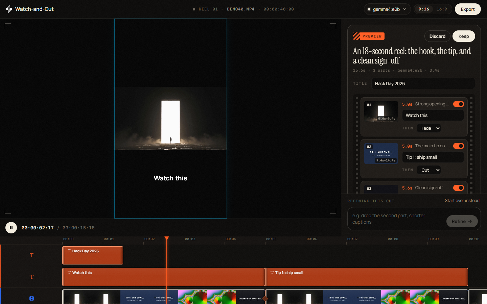
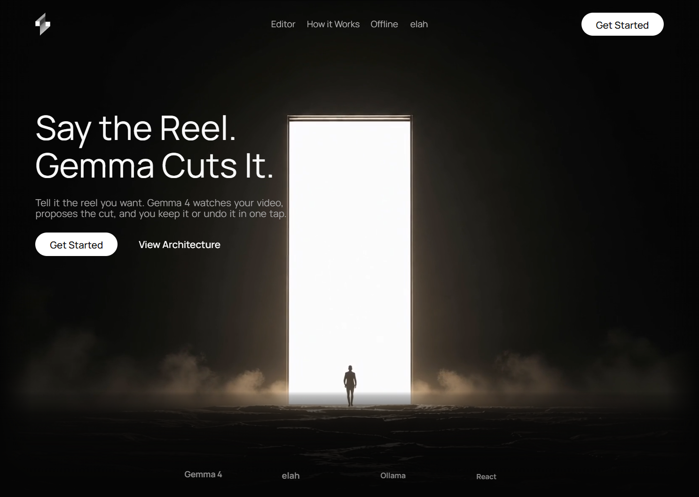
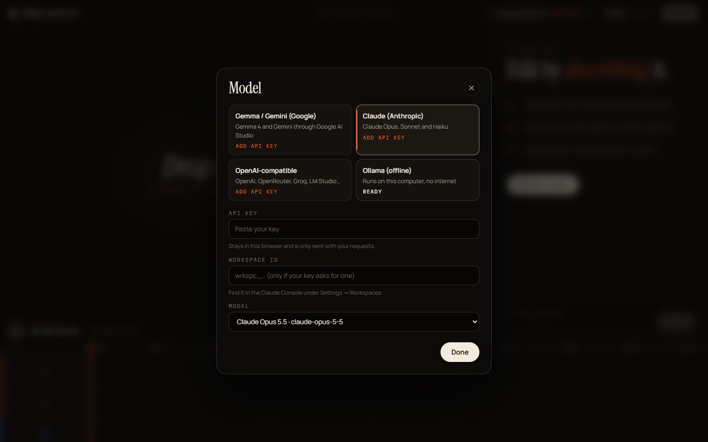
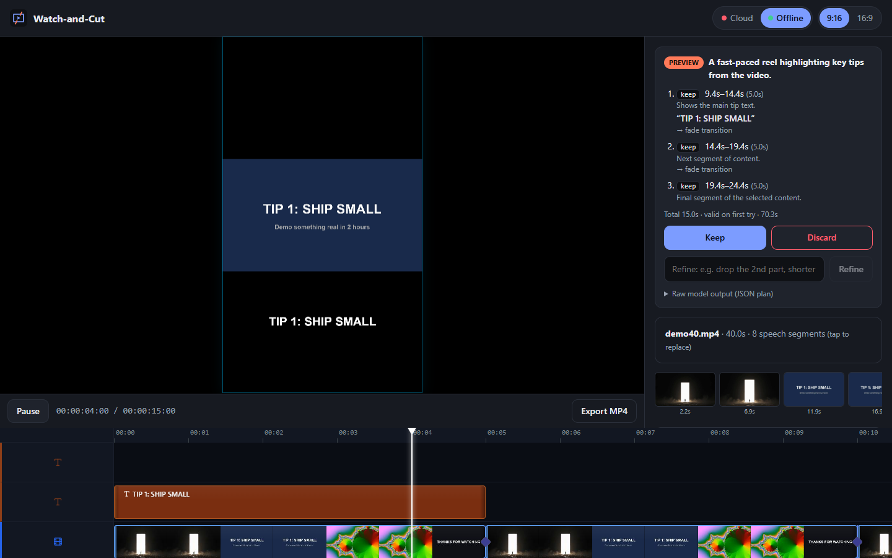

# Watch-and-Cut

> Describe the reel you want. Gemma 4 watches your video, proposes the cut, and you keep it or undo it in one tap.

Built for **Hacktoberfest Hack Day 2026 · Hyderabad** (MLH × DEV × React Hyderabad). It enters **Build on elah**. Cloud mode is also aimed at **Best Use of Gemma 4**, and offline mode at **Best Open-Source AI Project**.



## How it works

1. **Upload** a 1–3 minute video.
2. The browser samples 10 frames and finds speech pauses in the audio. This step uses plain code, no AI.
3. You type a request, for example *"Make a 20s reel of the best moments with captions"*.
4. The model you pick (**Gemma 4** by default, or Claude, any OpenAI-compatible model, or a local model) looks at the frames and the pause list, then returns a **JSON edit plan**. The plan is limited to four operations: `keep_segment`, `add_caption`, `add_title`, `add_transition`.
5. The plan is **validated** against the schema and timeline rules. If it fails, the model gets one retry with the errors. Cut points are snapped to speech pauses so they never land mid-word.
6. The valid plan goes onto the elah timeline as **one batched edit**, and you watch the preview.
7. **Keep**, **Discard** (one undo), or **Refine** ("drop the second part, shorter captions").

Unsupported requests (*"add a dancing robot"*) come back as `status: "unsupported"`, and the timeline is not touched.

See [HLD.md](HLD.md) for the full design.

| Landing page | Model settings | Offline run with Gemma 4 E2B |
| --- | --- | --- |
|  |  |  |

## Project layout

```
backend/    Node API on :8787. Calls the chosen provider: Gemma/Gemini, Claude, OpenAI-compatible, or Ollama
frontend/   Vite + React on :5173. Landing page (/), editor (/app.html). Proxies /api → backend
```

## Run it

Prerequisites: Node 20+, and an API key for at least one provider, or [Ollama](https://ollama.com) for offline use.

```bash
# 1. Backend
cd backend
npm install
cp .env.example .env.local      # add the keys you have (GEMINI_API_KEY, ANTHROPIC_API_KEY, OPENAI_API_KEY)
npm run dev                     # http://localhost:8787

# 2. Frontend (second terminal)
cd frontend
npm install
npm run dev                     # http://localhost:5173
```

Open http://localhost:5173 for the landing page, or http://localhost:5173/app.html for the editor.
To try it on a phone, open the "Network" URL that Vite prints. The phone must be on the same Wi-Fi.

### Choosing a model

Click the model chip in the editor's top bar. You can use:

| Provider | Models | Key |
| --- | --- | --- |
| Gemma / Gemini (Google) | Gemma 4 (default), any Gemini model your key can use | Google AI Studio |
| Claude (Anthropic) | Claude Opus 5.5 (default), Sonnet 5.5, Haiku 4.5 | Anthropic |
| OpenAI-compatible | Any vision model behind an OpenAI-style API: OpenAI, OpenRouter, Groq, LM Studio… | That provider's key |
| Ollama (offline) | Any model installed locally, e.g. `gemma4:e2b` | None |

Keys in `backend/.env.local` are used by default. Users can also paste their own key in the model settings; it stays in their browser and is sent only with their requests. Claude requests use structured outputs, so the plan always comes back as valid JSON.

### Offline mode (no internet)

```bash
ollama serve
ollama pull gemma4:e2b    # 4.6 GB; gemma4:e4b (6.6 GB) needs more RAM/VRAM
```

Switch the toggle in the editor to **Offline**. The video and frames never leave your machine.

### Checks

```bash
cd frontend
npm run typecheck
npm run selftest   # validate → apply → one-step undo, headless, on the real elah engine
```

## Tech

- [elah](https://github.com/elahlabs/elah) (`@elah/editor`): timeline, WebGL2 preview, undo history, MP4 export
- Gemma 4 through the Gemini API, Claude through the Anthropic SDK, any OpenAI-compatible API, and local models through Ollama
- React 19, Vite, TypeScript, zod

## Credits

- elah by ELAHlabs (Apache-2.0)
- The landing page background video is loaded from the CloudFront URL in the design brief
- Built with AI-assisted development (Claude Code)

## License

[Apache-2.0](LICENSE)
